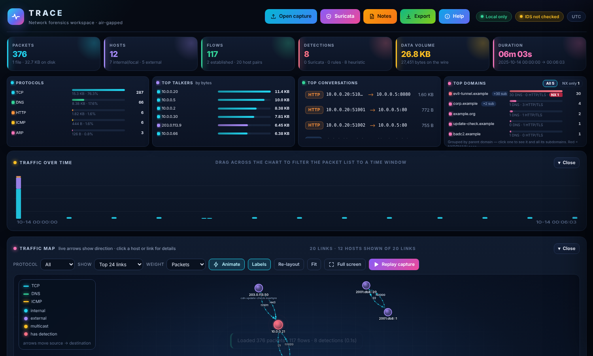

# TRACE — offline PCAP forensics in a single HTML file

**Open a packet capture, see what happened, and never send a byte off the machine.**

TRACE is a browser-based network-forensics workspace for PCAP / PCAPNG files. It is one self-contained
`index.html` — no install, no CDN, no cloud, no telemetry. Double-click it and drop in a capture.
An optional tiny local backend adds **real Suricata** detection when you want it.



Built for incident responders, SOC analysts and anyone who has to look at a capture on a machine that is
**not allowed to touch the internet** (IR laptops, jump hosts, air-gapped forensic workstations, customer sites).

---

## Why TRACE

| Problem | What TRACE does |
|---|---|
| Wireshark is great, but triage of a 2 GB capture is slow and manual | Streams the file in chunks, builds flows / hosts / timeline / protocol logs and surfaces leads automatically |
| Online PCAP analysers want you to upload evidence | Nothing leaves the machine. A strict Content-Security-Policy blocks every external request |
| IDS rules need a full sensor deployment | Run real Suricata locally on the file **or** use TRACE's built-in rule engine with no Suricata at all |
| Findings are hard to explain in a report | Every finding has structured context, linked evidence packets, ATT&CK tags, notes and one-click export |

## Features

- **Streaming PCAP / PCAPNG reader** — multi-GB capable, microsecond and nanosecond timestamps, Ethernet / VLAN / QinQ, Linux SLL, loopback, raw IP. IPv4 / IPv6, TCP / UDP / ICMP / ARP / SCTP.
- **Protocol decoding** — DNS, HTTP, TLS (SNI / ALPN / version), SSH, SMB, RDP; FTP / SMTP / POP3 / IMAP / Telnet labelling and cleartext-credential *type* detection (the secret itself is never displayed).
- **Packet explorer** — filter language, sortable columns, bookmarks, **rows per page (25–1000) with page jump on every table**.
- **Flows, Hosts, Timeline, Protocol logs** — each with search, filters and paging.
- **Details drawer** — decoded layers, coloured hex dump, follow-TCP-stream (best effort), save payload, back/next navigation.
- **Traffic map** — force layout with live direction arrows, hover focus, pan/zoom, protocol filter, full screen and **capture replay**. Per-flow **animated flow map with packet ladder**.
- **Detections** (clearly separated by source):
  - **Suricata** — real engine alerts, linked back to the matching packet and flow.
  - **Rules** — TRACE's built-in rule engine (no Suricata needed, subset of the rule language).
  - **Heuristic** — threshold-based triage leads (see [docs/DETECTIONS.md](docs/DETECTIONS.md)).
- **DNS / NXDOMAIN focus** — NXDOMAIN bursts, *distributed NXDOMAIN (random-subdomain) floods* with **every NX name listed**, top domains grouped by parent with an NX badge and NX-only toggle, `domain:` filter that includes subdomains.
- **Analyst workflow** — structured finding context, evidence buttons that open *all* related packets, quick and custom notes on findings / flows / packets, bookmarks, autosave.
- **Export** — filtered packets CSV/JSON, flows, hosts, detections, timeline, protocol logs, IOCs, HTML report, print/PDF.

## Quick start

### 1 · Browser only (no install)

1. Download `index.html` (or clone the repo).
2. Double-click it. Click **Open capture** and choose a `.pcap` / `.pcapng` — or drag it in.
3. Try the bundled synthetic captures in [`samples/`](samples/).

Developed and tested in Chromium (Chrome / Edge). Other modern browsers should work but are untested. Nothing to install.

### 2 · With Suricata (optional)

Requirements: Python 3.8+ (standard library only) and [Suricata](https://suricata.io/download/) installed locally. TRACE does not bundle Suricata; install it separately. Follow the step-by-step [Suricata installation and setup guide](docs/INSTALL-SURICATA.md) for Windows, Ubuntu/Debian and other platforms.

```bash
# Linux / macOS
./start.sh

# Windows
START-WINDOWS.bat
```

Then open <http://127.0.0.1:8765> → **Suricata → Check service → Run**.
The backend binds to `127.0.0.1` only, rejects non-loopback `Host`/`Origin` headers, uses a private temp folder and deletes it after each run.

Windows tips: Suricata is auto-detected in `C:\Program Files\Suricata`; otherwise set `SURICATA_BIN` and `SURICATA_CONFIG`.
See [docs/TROUBLESHOOTING.md](docs/TROUBLESHOOTING.md) for exit code `3221225781`, `modbus`/`dnp3` rule errors and harmless warnings.

## Rules — three ways to use them

Put `.rules` files in the **`rules/`** folder (or paste them in the Suricata dialog).

| Mode | Needs Suricata? | Notes |
|---|---|---|
| **Suricata + `rules/` folder** | Yes | Only your rules run (`-S`). Pasted rules are added on top. Full rule language. |
| **Suricata + `suricata.yaml` rules** | Yes | Uses whatever your Suricata install is configured with. |
| **TRACE built-in engine** | **No** | Per-packet matching of `content`, `pcre`, HTTP / DNS / TLS buffers, header / flow / flag checks. |

> **Can I copy Suricata's stock rules into `rules/` and drop Suricata?** No. Rules are only text; an engine has to run them.
> The built-in engine covers a subset (details in [docs/RULES-ENGINE.md](docs/RULES-ENGINE.md)). Rules that use
> unsupported keywords (`flowbits`, `byte_test`, `app-layer-event`, `flowint`, …) are **skipped and listed with the reason — never silently ignored**.
> In our test all 373 stock `*-events.rules` were skipped because they depend on Suricata's decoder.

## Filter syntax (Packets tab)

```
ip:10.0.0.5   ip:10.0.0.0/24   src:   dst:   port:443   sport:   dport:   proto:dns
flag:syn|synonly|synack|fin|rst|psh   len>500   dns:evil.com   http:/admin   sni:example   host:
has:"text"   flow:12   idx:100-200   file:name   rcode:nxdomain   domain:abc.com  (includes subdomains)
```

Prefix a term with `-` or `!` to negate; combine terms with spaces.
Shortcuts: `/` search · `j` / `k` next / previous packet · `b` bookmark · `Esc` close.

## Documentation

| Doc | What's in it |
|---|---|
| [docs/USER-GUIDE.md](docs/USER-GUIDE.md) | Tab-by-tab walkthrough and an analyst triage workflow |
| [docs/DETECTIONS.md](docs/DETECTIONS.md) | Every heuristic, its trigger and what to check next |
| [docs/RULES-ENGINE.md](docs/RULES-ENGINE.md) | Supported / unsupported rule keywords, how matches are aggregated |
| [docs/ARCHITECTURE.md](docs/ARCHITECTURE.md) | How the reader, decoders, engine and backend fit together |
| [docs/SECURITY-AND-PRIVACY.md](docs/SECURITY-AND-PRIVACY.md) | The air-gap design and its limits |
| [docs/TROUBLESHOOTING.md](docs/TROUBLESHOOTING.md) | Common errors and fixes |
| [docs/INSTALL-SURICATA.md](docs/INSTALL-SURICATA.md) | Suricata install, rules, validation and TRACE integration |

## Tests

Automated browser tests (Playwright / headless Chromium) cross-check the decoder against `tcpdump`, compare the built-in rule engine against the **locally installed Suricata version**, and assert zero JS errors and zero external requests.

```bash
pip install playwright && playwright install chromium     # test-time only
sudo apt install tcpdump suricata                         # Linux example; use your OS package/install guide
pip install -r requirements-dev.txt && playwright install chromium
python tests/run_all.py                                    # browser tests (tcpdump required)
# Optional Suricata tests: start backend in another terminal, then:
python backend.py &  python tests/run_all.py --with-suricata   # adds Suricata comparison and end-to-end tests
```

What the tests do **not** prove is listed under *Limitations*.

## Repository layout

```
index.html          the entire application (open this)
backend.py          optional local Suricata bridge (Python stdlib only)
start.sh / START-WINDOWS.bat
rules/              your .rules files (example included)
samples/            small SYNTHETIC captures for trying the tool
docs/               guides and screenshots
tests/              browser + Suricata test suites and fixtures
tools/              scripts that generate the synthetic captures (needs scapy)
posts/              launch write-ups (LinkedIn / Medium drafts)
```

## Limitations (please read)

- **Tested on Linux in headless Chromium.** The Windows launcher and Windows Suricata paths are implemented but **not tested** by the maintainers' automated suite.
- **Heuristics are thresholds, not proof.** A finding is a lead to verify, not a verdict. Zero alerts does not mean traffic is benign.
- **No decryption.** Encrypted payloads stay encrypted; TLS is analysed via handshake metadata.
- **TCP reassembly is best effort** (limited out-of-order / overlap handling; 4,000 packets / 1.5 MiB per followed stream).
- **The built-in rule engine is per-packet with no TCP reassembly** and supports a subset of keywords. It matched Suricata on 17 test rules (16 runnable, 1 skipped); that is a spot check, not a certification. Use Suricata for anything critical.
- Packet metadata lives in browser memory; for very large captures use the packet limit in the Open dialog.
- The bundled sample captures are **synthetic** (generated by `tools/`), not real attack traffic.

## Release verification status

The automated suite is provided for contributors, but platform coverage varies. Review [RELEASE-VALIDATION.md](RELEASE-VALIDATION.md) before relying on a release; the browser tests require Playwright Chromium and Suricata tests require a local Suricata installation.

## Contributing

Issues and PRs are welcome — see [CONTRIBUTING.md](CONTRIBUTING.md). Security reports: [SECURITY.md](SECURITY.md).

## License

[MIT](LICENSE). Use it, fork it, adapt it to your SOC.

## Disclaimer

TRACE is provided as is for lawful analysis of network captures you are authorised to inspect.
Findings are indicators for human review and do not constitute proof of compromise.
